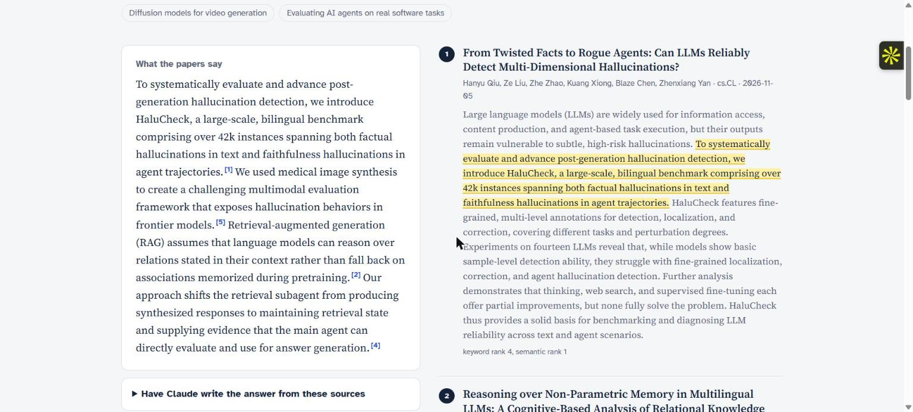
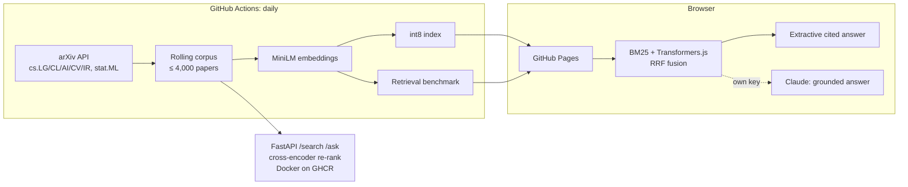

# Paper Trail: a RAG assistant over the newest machine-learning research

[](https://github.com/PalakGupta7456/rag-research-assistant/actions/workflows/ci.yml)
[](https://github.com/PalakGupta7456/rag-research-assistant/actions/workflows/build-index.yml)
  

**Live app: https://palakgupta7456.github.io/rag-research-assistant/**

Ask a question and get an answer **assembled from, and cited to,** the newest arXiv papers in machine learning, NLP, computer vision and IR. The corpus refreshes daily. Retrieval is **hybrid**: BM25, plus dense embeddings, fused with Reciprocal Rank Fusion. It runs **inside your browser** with Transformers.js, so the live demo needs no server at all.



## Why it is built this way

| Concern | Approach |
|---|---|
| **Grounding** | Answers are extractive by default: the sentences most similar to the question, taken from the top papers, each with a `[n]` citation and highlighted in its source. The optional Claude answer is restricted to the numbered sources by the system prompt, and must say so when they don't contain the answer. |
| **Hallucinated citations** | `citation_precision` checks that every `[n]` points at a real retrieved source. The CI smoke test requires it to be 1.0. |
| **Retrieval quality** | Keyword search misses paraphrases and dense search misses rare exact terms (model names, acronyms). Hybrid search with RRF needs no score calibration between the two. A cross-encoder re-ranker is available server-side. |
| **Measured, not assumed** | Every index build reruns a retrieval benchmark: BM25 vs dense vs hybrid vs hybrid with re-ranking, reporting Hit@k, MRR@10 and latency. The results are shown on the page. |
| **Serverless** | GitHub Actions builds the index daily. The browser downloads an **int8-quantised** index (4× smaller than float32, max cosine error under 0.06, checked on every build) and embeds queries locally in WebAssembly. |
| **Train/serve consistency** | The index is built with `sentence-transformers` in Python and queried with Transformers.js in the browser. A CI job embeds the same sentences in both and fails if cosine agreement drops below 0.97. |
| **Cost and privacy** | The optional LLM step uses the visitor's own Anthropic key, which is sent directly from the browser to Anthropic and kept only in that tab. Nothing passes through a server of ours. |

## Evaluation protocol

There are no hand labels, so it uses **title → abstract known-item retrieval**. Each paper's title is the query, and its abstract (with the title removed) is the single relevant document. A title is a short paraphrase of its abstract, so this tests whether a retriever can find a specific paper from a rewording. The live page shows the current numbers.

## Architecture



## API (Docker)

```bash
docker run -p 8000:8000 -e ANTHROPIC_API_KEY=... ghcr.io/palakgupta7456/rag-research-assistant
curl "localhost:8000/search?q=speculative%20decoding&mode=hybrid+rerank"
curl -X POST localhost:8000/ask -H 'content-type: application/json' \
     -d '{"question": "How are people reducing hallucination in RAG?"}'
```

Without an API key, `/ask` answers extractively. With a key, Claude writes the answer and the response includes token usage.

## CI/CD

| Workflow | What it does |
|---|---|
| `ci.yml` | ruff lint; pytest (arXiv parsing, BM25, RRF, quantisation error, evaluation above chance, cited answers, API); Python ↔ browser embedding parity; Docker build, then an `/ask` smoke test that checks citation precision, then a push to GHCR |
| `build-index.yml` | daily: fetch, embed, benchmark, publish the int8 index to GitHub Pages, save the corpus on the `live-data` branch |

## Run locally

```bash
pip install torch --index-url https://download.pytorch.org/whl/cpu
pip install -e ".[ml,llm,api,dev]"
python -m rag.build                      # or: python -m rag.build --lightweight --synthetic (offline)
python -m http.server -d docs 8080       # browser app
uvicorn api.main:app --reload            # API
pytest
```

## Limitations and next steps
- Only abstracts are indexed. Full-text PDF chunking would answer deeper questions.
- The benchmark is a proxy for real questions. A small human-labelled question set, plus LLM-judged answer faithfulness, would complete the evaluation.
